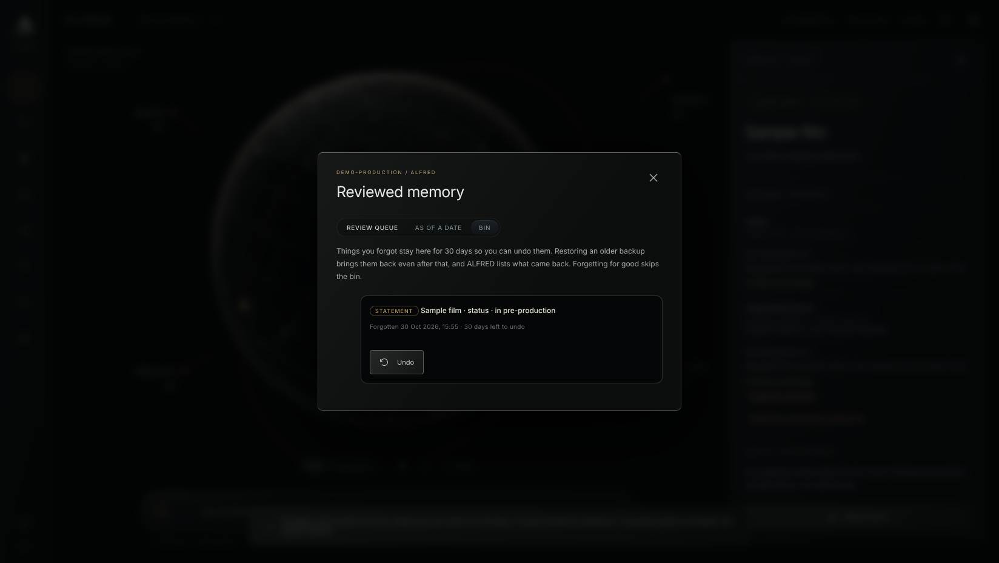

# Two-layer delete receipt (M05, MEM-010)

30 October 2026. Branch `claude/project-thread-9npowk` (PR #26), on top of encryption phase 1
step 1. Tested revision: the commit that adds this receipt (a commit cannot name itself; its
hash is in the pull request). Synthetic data only. Nothing under `third_party/` was read,
imported or run, and no model ran.

## The rule

On 22 October 2026 the owner replaced M05's "no resurrection after restore" with two layers:

> if something is restored from a backup it needs to be restored... unless we have a absolute
> delete which should be a different layer

- **Ordinary forget**, the everyday action. The statement, record or source leaves everyday
  ALFRED. A statement or record waits in a bin for 30 days, where the owner can undo it. A
  restore from an older backup brings it back like everything else the backup holds, and the
  restore lists what came back.
- **Absolute forget**, a separate, deliberate action with its own confirmation. It skips the
  bin, removes any copy already there, and every restore applies it again, so no backup brings
  it back. Older backups keep a copy until they are replaced.

Defaults chosen where the rule did not say:

- Revocations (credentials, grants, stopped goals) always hold through a restore, as before.
- Retention the owner set when capturing a statement ends absolutely: no bin, holds through a
  restore, and a copy already in the bin goes too. A statement forgotten ordinarily before its
  retention ended is journalled again as absolute when it ends, even after its bin copy left.
- A whole source has no bin (the owner's files are untouched, so adding the folder again reads
  them again), but follows the two layers on restore. Removing it absolutely after an ordinary
  removal still empties bin copies of its statements, found through the source's tombstones.
- Answers and drafts a forget withdrew stay withdrawn after an undo; the undo says so.
- Journal entries written before the layers existed count as absolute, so nothing forgotten
  earlier comes back.

## What was built

- **Journal layer** (`alfred/lifecycle.py`). Each forget entry carries `layer`, `ordinary` or
  `absolute`; entries without it count as absolute and an unknown layer stops a restore as a
  corrupt journal. A new `forget_undone` entry records an undo. Receipts carry `layer`, and an
  ordinary receipt carries `undo_until`. What a receipt says remains is worded per layer.
- **Restore.** Absolute forgets and revocations are applied again; ordinary forgets are not.
  The result adds `came_back` (each ordinary forget the restored copy holds again, with a
  short label and when it was forgotten, unless a later undo or absolute forget settled it)
  and `ordinary_entries_not_replayed`. `python3 -m alfred.desk restore` prints what came back.
- **The bin** (`alfred/memory_bin.py`, table `memory_bin`). An ordinary forget of a statement
  or record keeps the values it cleared and, for a record, its name, for 30 days. Only the
  owner sees their bin. An absolute forget of a statement, record or source removes every copy
  that holds it, including a statement held inside a record's copy. The supervisor empties
  copies past their 30 days on each cycle, with an audit entry per copy.
- **Undo** (`ReviewedMemory.undo`). Puts a statement back in the state it had, with its value,
  and a record back with its name and the statements forgotten with it. It refuses when the
  copy has gone (`not_in_bin`), when a statement's record is not there now
  (`undo_record_first`), and when a new record took the identifier
  (`memory_entity_id_unavailable`). When a record comes back, a statement that also names
  another record still forgotten stays in the bin as a statement, until the same time, so it
  can come back once that record does. History records the change as `undone_from_bin`.
- **Absolute forget.** `{"absolute": true, "confirm": "<id>"}` on
  `POST /desk/memory/claims/{id}/forget` and `/desk/memory/entities/{id}/forget`, and
  `{"confirm": "<id>", "absolute": true}` on `/desk/sources/{id}/forget`. A missing or wrong
  `confirm` gives `confirmation_mismatch`. Asking for an absolute forget of something already
  ordinarily forgotten upgrades it: a new journal entry and receipt, and the bin copy goes.
- **HTTP.** `GET /desk/memory/bin` and `POST /desk/memory/bin/{id}/undo`, owner only, CSRF
  checked like every other change.
- **Deletion report.** A new category, `bin_copies`, counts bin copies that hold the subject,
  with values, so receipts and the report stay honest.
- **Console.** A Bin tab in Reviewed memory lists what can still be undone, with the days
  left and an Undo button. Forgetting a statement or record, and removing a source, explain
  both layers, with a separate "for good" tick box that changes the button to
  "Forget for good" (or "Remove for good").

## Tests and checks

Run in a scratch worktree with the pinned `cryptography` 50.0.2 virtual environment.

| Command | Result |
|---|---|
| `python -m unittest discover -s tests -p test_two_layer_delete.py` | 23 tests pass (20 written first, all failing before the change; three added in review, each failing before its fix: a statement that names a record still forgotten, retention ending after the bin emptied, and an absolute source removal after an ordinary one) |
| `python -m unittest discover -s tests` | full suite, see the pull request for the count on the tested commit |
| `npm run build`, `npm test` in `console/` | build passes; 19 files, 179 unit tests pass |
| `npm run test:browser` in `console/` | 29 browser tests pass |
| `tools/check_console_connected_browser.py` | 114 checks pass, including the bin, undo and forget for good |
| `tools/check_temporal_review_browser.py` | 54 checks pass, including the Bin tab at 1280 and 390 pixels wide |
| `tools/check_public_hygiene.py`, `egress_audit.py`, `check_adoptions.py`, `check_claims.py`, `check_requirement_register.py`, `check_memory_plan.py` | ok |

Older tests whose purpose was "a restore never brings a forget back" now use an absolute
forget, which keeps that purpose; the ordinary layer has its own tests that it does come back.
The tests changed this way are in `tests/test_memory_lifecycle.py`,
`tests/test_deletion_accounting.py`, `tests/test_memory_temporal.py` and
`tests/test_drafts_archive.py`.

## Not done

- Bin copies are not sealed yet. Encryption step 2 adds `memory_bin` to the sealed tables.
- No "empty the bin now" action; copies leave after 30 days or with an absolute forget.
- The console has no "forget for good" button in the bin. The server upgrades an ordinary
  forget when asked; in the console, undo it and forget it again with "for good" ticked.
- An undo does not bring back withdrawn answers or drafts.
- Old backups still hold a copy of an absolute forget until they are replaced. Rotating or
  deleting old backups is not automated.
